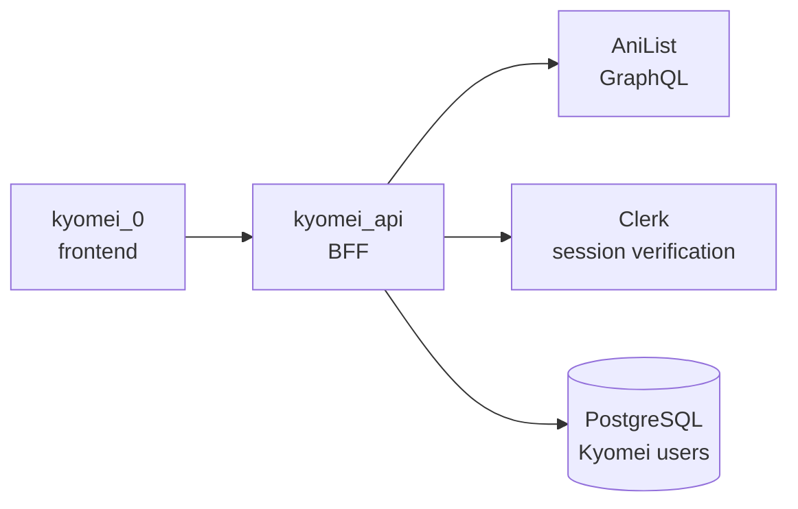

# Kyomei — 共鳴 (`kyomei_api`)

> Anime recommendations that resonate with you.

[](https://github.com/DavidRaet/kyomei_api/actions/workflows/ci.yml)


<!-- HUMAN INPUT: Add links here if applicable — e.g. a live demo URL, a hosted /docs URL, or the frontend (kyomei_0) repo link. Leave blank/remove if none exist yet. -->
[Demo] [API Docs]

---

## Overview

`kyomei_api` is a FastAPI backend-for-frontend (BFF) for [`kyomei_0`](https://github.com/DavidRaet/kyomei_0), a TypeScript/Vite anime-tracking client. It provides anime metadata from [AniList](https://anilist.co) (GraphQL) and a Clerk-authenticated current-user endpoint backed by Kyomei user records. Personalized recommendations and other persisted user data are not implemented yet (see `docs/Kyomei-MVP-PRD-v2.1.md`).

<!-- HUMAN INPUT: Explain, in plain language for a non-technical reader, what Kyomei is and why it exists. -->

## Why Kyomei?

<!-- HUMAN INPUT: Explain why Kyomei exists, the problem you wanted to solve, your product philosophy, and what "resonance" (共鳴) means to you in this context. -->

## Current Status

This repository is **a working BFF for all five v1 anime endpoints, with CORS, per-IP rate limiting, and request logging in place — not yet a completed recommendation engine, and not yet caching anything.** Concretely, per `docs/fastapi-backend-setup-checklist.md`:

**Done:**
- Repo/project structure, `uv`-based dependency management, `ruff` lint/format config, `justfile` commands, a `pre-commit` hook (`ruff check`, `ruff format --check`, `pytest`)
- `GET /health`, five anime endpoints, and Clerk-authenticated `GET /v1/me`, which returns the internal Kyomei user ID
- `app/anime/` (models, errors, `Provider` protocol) and `app/anilist/client.py` (the AniList GraphQL client) — domain logic and upstream client
- CORS middleware scoped to configured origins, per-IP rate limiting (`slowapi`, 429s on breach) and structured request logging — all wired in `app/main.py`
- `app/config.py` loads settings with `pydantic-settings`; production startup requires Clerk credentials/authorized parties and `DATABASE_URL`
- Async SQLAlchemy database sessions, a Kyomei user model, and an Alembic migration are present; `/v1/me` persists user mappings
- Tests: router-level (`tests/test_routers_anime.py`, a fake `Provider`), AniList client unit tests against mocked HTTP responses (`tests/test_anilist_client.py`, `respx`), an integration test against a running server (`tests/test_integration_health.py`), plus CORS/rate-limit/logging tests
- `Dockerfile` (multi-layer `uv sync` build) verified locally
- CI (`.github/workflows/ci.yml`): lint + test + Docker build on every PR
- Deployed to Railway with environment variables mirrored from `.env.example`
**Not yet done:**
- **Caching** — `app/cache/` is still an empty stub module. Every request currently hits AniList directly; `CACHE_TTL_SECONDS` exists as a setting but nothing reads it yet, so despite `CONTRACT.md` describing these responses as cached, none of them are
- Preferences, ratings, watchlists, and recommendation logic (see [Roadmap](#roadmap))

<!-- HUMAN INPUT: Add narrative framing of where the project stands and what "done" means for this phase, if you want more than the checklist summary above. -->

## Architecture

`kyomei_api` is a BFF, not the recommendation engine described in the PRD — it orchestrates AniList calls and exposes a Clerk-authenticated identity boundary. Caching is not implemented yet.



Today, each request follows the same path: query AniList, then return a normalized `AnimeSummary`/`AnimeDetail`/`CharacterSummary` shape (see `CONTRACT.md`). The single-anime lookup (`GET /v1/anime/{malId}`) returns the richer `AnimeDetail`, which extends `AnimeSummary`; search, trending, and seasonal all return plain `AnimeSummary` lists.

Each anime request currently queries AniList directly; the cache module remains a stub. `/v1/me` verifies the Clerk session token, finds or creates the linked Kyomei user, and returns its internal UUID as `userId`.

AniList is the only upstream source in v1; there's no fallback provider (see `docs/Kyomei-MVP-PRD-v2.1.md`'s Design Decisions for why Jikan was dropped instead of kept as a fallback). Every request also passes through CORS, per-IP rate limiting, and request-logging middleware before it reaches a router.

## Tech Stack

| Layer | Choice | Source |
|---|---|---|
| Language / runtime | Python 3.14 | `.python-version` |
| Package manager | [`uv`](https://docs.astral.sh/uv/) | `pyproject.toml`, `uv.lock` |
| Web framework | FastAPI (≥0.141) | `pyproject.toml` |
| ASGI server | Uvicorn (`[standard]`, ≥0.52) | `pyproject.toml` |
| Outbound HTTP client | `httpx` (≥0.28) — used by the AniList client and integration tests | `pyproject.toml` |
| Config loading | `pydantic-settings` (≥2.15) | `pyproject.toml`, `app/config.py` |
| Authentication | Clerk Backend SDK | `pyproject.toml`, `app/auth/` |
| Database | SQLAlchemy async + psycopg, Alembic | `pyproject.toml`, `app/database/`, `alembic/` |
| Rate limiting | `slowapi` (≥0.1.9) — per-IP, in `app/rate_limit.py` | `pyproject.toml`, `app/rate_limit.py` |
| Lint/format | `ruff` (≥0.16) | `pyproject.toml`, `justfile` |
| Testing | `pytest` (≥8.0), `respx` (mocked HTTP for AniList client tests) | `pyproject.toml`, `tests/` |
| Pre-commit | `pre-commit` (≥3.8) — runs `ruff check`, `ruff format --check`, `pytest` | `.pre-commit-config.yaml`, `justfile` |
| Containerization | Docker, `ghcr.io/astral-sh/uv:python3.14-bookworm-slim` base image | `Dockerfile` |
| CI | GitHub Actions | `.github/workflows/ci.yml` |
| Hosting | Railway | `docs/fastapi-backend-setup-checklist.md` §8 |

## Project Structure

```
kyomei_api/
├── app/
│   ├── main.py             # FastAPI app creation, lifespan-managed AniListClient, CORS + rate-limit + logging middleware, GET /health, mounts app/routers/anime.py — wiring only
│   ├── anime/              # domain logic: models.py, errors.py, provider.py (Provider Protocol) — implemented; no separate orchestration/service.py yet
│   ├── anilist/            # client.py — async AniList GraphQL client (httpx) — implemented
│   ├── cache/              # stub; response caching is not implemented
│   ├── auth/               # Clerk token verification, auth errors, and CurrentUser abstraction
│   ├── database/           # async SQLAlchemy sessions and Kyomei user model
│   ├── routers/            # anime.py and auth.py endpoints, schemas, and exception handlers
│   ├── rate_limit.py       # slowapi Limiter + 429 handler — implemented
│   ├── logging_config.py   # request logging middleware — implemented
│   └── config.py           # pydantic-settings env/config loading; PORT is served by Uvicorn and cache TTL is not yet used
├── alembic/                # migration configuration and users table migration
├── tests/
│   ├── conftest.py
│   ├── test_health.py
│   ├── test_routers_anime.py
│   ├── test_anime_models.py
│   ├── test_anilist_client.py
│   ├── test_integration_health.py
│   ├── test_cors.py
│   ├── test_rate_limit.py
│   ├── test_logging.py
│   ├── test_auth.py
│   └── test_database.py
├── docs/
│   ├── Kyomei-MVP-PRD-v2.1.md
│   ├── fastapi-backend-setup-checklist.md
├── CONTRACT.md
├── Dockerfile
├── justfile
├── pyproject.toml / uv.lock
└── .env.example
```

## Getting Started

**Prerequisites:** Python 3.14 (see `.python-version`) and [`uv`](https://docs.astral.sh/uv/getting-started/installation/).

```bash
git clone https://github.com/DavidRaet/kyomei_api.git
cd kyomei_api
uv sync
cp .env.example .env
just run   # = uv run python -m uvicorn app.main:app --reload
```

The server starts on `http://localhost:8000` (or `$PORT` if set). Verify it's up:

```bash
curl http://localhost:8000/health        # {"status": "ok"}
```

Swagger UI is available at `http://localhost:8000/docs` (auto-generated by FastAPI; documents `/health`, the anime routes, and `/v1/me`).

**Run with Docker instead:**

```bash
docker build -t kyomei-api .
docker run --rm -p 8000:8000 kyomei-api
```

## API Documentation

The authoritative contract is [`CONTRACT.md`](./CONTRACT.md) — it is copy-pasted verbatim into both this repo and the frontend (`kyomei_0`) repo. If an endpoint, field, or status code isn't listed there, it doesn't exist yet.

| Method | Path | Status |
|---|---|---|
| `GET` | `/health` | **Implemented** (rate-limited like every other endpoint) |
| `GET` | `/v1/anime/{malId}` | **Implemented** (not yet cached — see [Current Status](#current-status)) |
| `GET` | `/v1/anime/search` | **Implemented** (not yet cached — see [Current Status](#current-status)) |
| `GET` | `/v1/anime/trending` | **Implemented** (not yet cached — see [Current Status](#current-status)) |
| `GET` | `/v1/anime/seasonal` | **Implemented** (not yet cached — see [Current Status](#current-status)) |
| `GET` | `/v1/anime/{malId}/characters` | **Implemented** (not yet cached — see [Current Status](#current-status)) |
| `GET` | `/v1/me` | **Implemented** (requires a valid Clerk session token) |
| `POST` | `/v1/recommendations` | Proposed only — not part of the current contract |

Anime endpoints and `/health` are public; `/v1/me` requires a Clerk session token in `Authorization: Bearer <token>`. Exceeding the per-IP rate limit returns `429` with `code: "rate_limited"`. See `CONTRACT.md` for response shapes, status codes, and examples.

## External Data Sources

| Source | Role | Protocol | Base URL (default) |
|---|---|---|---|
| [AniList](https://docs.anilist.co/guide/graphql/) | Sole data source (no fallback) | GraphQL | `https://graphql.anilist.co` |

## Configuration

Environment variables (see `.env.example`), loaded via `app/config.py`'s `pydantic-settings` `Settings` class.

| Variable | Default | Purpose | Actually read? |
|---|---|---|---|
| `PORT` | `8000` | Port Uvicorn binds to (Railway sets this in prod) | No — Uvicorn's own `$PORT` handling (see Deployment) is what actually binds the port; `Settings.port` isn't consulted |
| `ANILIST_ENDPOINT` | `https://graphql.anilist.co` | AniList GraphQL endpoint | Yes — passed into `AniListClient` at startup in `app/main.py` |
| `CACHE_TTL_SECONDS` | `300` | Planned in-memory cache entry lifetime | No — `app/cache/` isn't implemented yet |
| `CORS_ALLOWED_ORIGINS` | `http://localhost:5173,https://kyomei-0.vercel.app` | Comma-separated origins allowed by `CORSMiddleware` | Yes — parsed in `app/config.py`, applied in `app/main.py` |
| `RATE_LIMIT_PER_MINUTE` | `60` | Per-IP request limit (`slowapi`) | Yes — `app/rate_limit.py` |
| `RATE_LIMIT_ENABLED` | `true` | Toggles rate limiting on/off | Yes — `app/rate_limit.py` |
| `CLERK_SECRET_KEY` | unset | Clerk backend secret used to verify session tokens | Required in production; optional in development |
| `CLERK_AUTHORIZED_PARTIES` | `http://localhost:5173,http://localhost:4173` | Comma-separated trusted frontend origins for Clerk token verification | Required in production; optional in development |
| `DATABASE_URL` | local PostgreSQL URL in `.env.example` | PostgreSQL connection URL | Creates an async SQLAlchemy engine when non-empty; required in production |

## Testing

```bash
just test   # = uv run python -m pytest
uv run pytest tests/test_health.py::test_health_returns_ok   # single test
just hooks-run   # run the pre-commit hook (ruff check, ruff format --check, pytest) on demand
```

Current coverage:
- `tests/test_health.py` — `GET /health`
- `tests/test_routers_anime.py` — all five `/v1/anime/...` endpoints against a fake `Provider`, covering success, 404, 400, and 500 paths
- `tests/test_anime_models.py` — Pydantic model validation for `AnimeSummary`/`AnimeDetail`/`CharacterSummary`/`VoiceActorSummary`
- `tests/test_anilist_client.py` — `AniListClient` unit tests against mocked HTTP responses (`respx`)
- `tests/test_integration_health.py` — integration test against a real Uvicorn server bound to a free local port
- `tests/test_auth.py`, `tests/test_database.py` — Clerk identity verification/configuration and database setup
- `tests/test_cors.py`, `tests/test_rate_limit.py`, `tests/test_logging.py` — CORS, per-IP rate limiting, and request-logging middleware

`.pre-commit-config.yaml` runs `ruff check`, `ruff format --check`, and `pytest` before each commit — install with `just hooks-install`.

## CI/CD

`.github/workflows/ci.yml` runs two independent jobs on every PR and on push to `main`:

- **`lint-and-test`** — `uv sync`, `uv run ruff check`, `uv run pytest`
- **`docker-build`** — `docker build` only (no push/deploy)

See `docs/learning/cicd-notes.md` for the reasoning behind running these as separate parallel jobs.

## Deployment

The service is containerized via `Dockerfile`:

- Base image: `ghcr.io/astral-sh/uv:python3.14-bookworm-slim`
- Dependencies are installed in a layer separate from application code (`COPY pyproject.toml uv.lock ./` → `uv sync --no-install-project`, then `COPY app ./app` → `uv sync`), so editing source doesn't invalidate the dependency-install layer
- `CMD` reads `$PORT` at runtime via shell form (`sh -c "uvicorn ... --port ${PORT:-8000}"`), falling back to `8000` locally

Deploy target is **Railway** (per `docs/fastapi-backend-setup-checklist.md` §8), with environment variables mirrored from `.env.example`.

For PostgreSQL, set the API service's `DATABASE_URL` variable to `${{Postgres.DATABASE_URL}}` in Railway. Run `uv run alembic upgrade head` before serving `/v1/me`.

Database integration tests use `TEST_DATABASE_URL` and skip when it is unset. Point it at a disposable PostgreSQL database with migrations applied; without it, `just test` does not write to the app's `DATABASE_URL`.

<!-- HUMAN INPUT: Add a live URL here if the Railway deployment is publicly reachable, or note current deployment/traffic status. -->

## Engineering Decisions

- **FastAPI over Go** — this repo originally started as a Go scaffold (just `go mod init`, no actual source code). Per the PRD's "Design Decisions" section, the language was switched to Python/FastAPI because the core recommendation logic is a data-shaping/ranking problem that fits Python's ecosystem better, and FastAPI's async design plus Pydantic validation map closely onto the TypeScript interfaces already fixed in `CONTRACT.md`. The Go scaffold was retired (`go.mod` removed, `.gitignore` switched to Python-flavored) since there was no Go code to carry over.
- **Two independent CI jobs, not one** — `lint-and-test` and `docker-build` run in parallel so a slow Docker build never delays lint/test feedback on a PR (see `docs/learning/cicd-notes.md`).
- **Two-stage `uv sync` in the Dockerfile** — dependencies are installed before app code is copied in, so Docker's layer cache means editing application code doesn't re-trigger a dependency reinstall (see `docs/learning/docker-notes.md`).
- **Clerk identity boundary, Kyomei user persistence** — `/v1/me` verifies Clerk session tokens and returns a stable internal Kyomei user UUID. The first request creates its database row.
- **AniList as the sole upstream source, no Jikan fallback** — a Jikan REST client was built (`app/jikan/`) and then removed. Jikan isn't an official API — it's an unofficial wrapper around the MyAnimeList website — so it was flaky and easy to rate-limit. A fallback that's unreliable doesn't add resilience; it just adds a second point of failure. See `docs/Kyomei-MVP-PRD-v2.1.md`'s Design Decisions for the full writeup.

<!-- HUMAN INPUT: Explain the reasoning for choosing uv over Poetry (the setup checklist notes this explanation belongs here but doesn't state the reason itself). Add any other personally-made architectural tradeoffs, rejected alternatives, or lessons learned. -->

## Roadmap

Near-term (from `docs/fastapi-backend-setup-checklist.md`'s remaining unchecked sections and `CONTRACT.md`'s "Proposed / Not Yet Confirmed"):

- Implement `app/cache/` (in-memory TTL cache, e.g. `cachetools.TTLCache`) and wire `CACHE_TTL_SECONDS` into it — the biggest remaining gap, since `CONTRACT.md` already describes lookups/search/trending/seasonal/characters as cached
- Frontend cutover: point `kyomei_0`'s `animeProvider.ts` fully at this backend and retire its client-side AniList/Jikan fallback once reliability is confirmed
- `POST /v1/recommendations` and watchlist endpoints (drafted in `CONTRACT.md`, not implemented — gated on personalization/auth work)

Next steps: add Kyomei-owned preferences and ratings against the internal user ID, then build personalized recommendation logic. Shared anime response caching also remains unimplemented.

<!-- HUMAN INPUT: Add product-vision-level roadmap and prioritization beyond the technical checklist items above. -->

## Contributing

<!-- HUMAN INPUT: State whether this project accepts contributions and, if so, how. -->

## License

<!-- HUMAN INPUT: No LICENSE file currently exists in this repository — choose and add one (e.g. MIT) if you want the project openly licensed. -->

## Acknowledgements

<!-- HUMAN INPUT: Credit anyone/anything you'd like to acknowledge (e.g. AniList as a data provider, prior art, people who helped). -->
